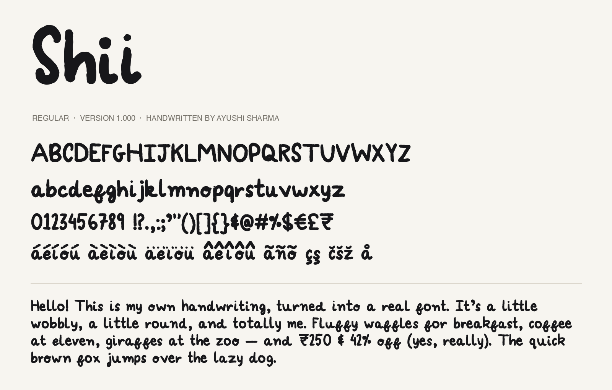

# Shii

A handwriting font made from my own handwriting.



## Get the font

- **Install:** download [`release/Shii-Regular.otf`](release/Shii-Regular.otf) and double-click it.
- **Websites:** use [`release/Shii-Regular.woff2`](release/Shii-Regular.woff2):

```css
@font-face {
  font-family: "Shii";
  src: url("Shii-Regular.woff2") format("woff2");
  font-display: swap;
}
```

Letters rotate between hand-drawn versions as you type, so repeated letters don't look stamped.

## How it's made

1. Write every character on the sheets in [`sheets/`](sheets) (Procreate canvases in `sheets/procreate/`, printable PDF in `sheets/shii_sheets_1-3.pdf`, see `sheets/writing_guide.pdf`).
2. Export the Procreate file as PSD (template + ink layer per sheet) into `input/`.
3. Build:

```bash
python3 -m venv .venv && .venv/bin/pip install -r requirements.txt
.venv/bin/python tools/build_font.py
.venv/bin/python tools/make_tuner.py
```

4. Fine-tune spacing, kerning and line height in `font_tuner.html`, and pick which letter versions to use in `variants_review.html`. Both save into [`tuning.json`](tuning.json), then rebuild.

The source PSD isn't included in this repo.
